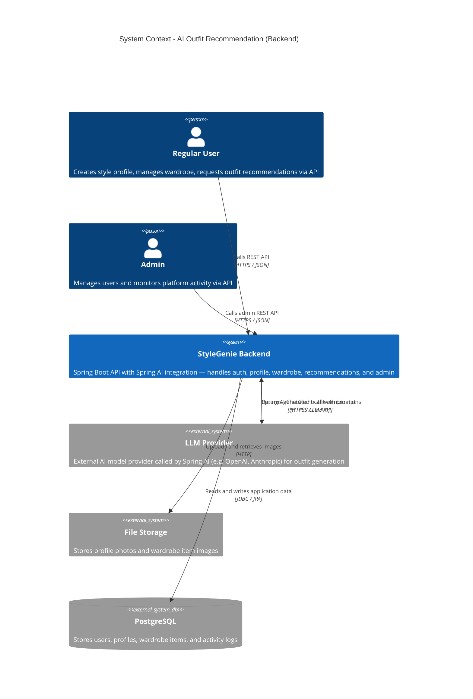

# AI Outfit Recommendation - System Context

## System Overview

StyleGenie's AI outfit recommendation system is a Spring Boot backend that enables regular users to create a style profile (body shape, face shape, skin tone + profile photo), manage a digital wardrobe with item photos, and receive AI-generated outfit combinations. The AI recommendation logic is powered by **Spring AI** — integrated directly within the Spring Boot application. An admin panel provides platform oversight.

UI is out of scope for this inception; only the backend API is being specified here.

## Context Diagram

## External Integrations

- **LLM Provider (via Spring AI)**: Spring AI's `ChatClient` sends a structured prompt (containing the user's style traits, occasion, and wardrobe item descriptions) to the configured LLM provider. Returns natural-language outfit combinations. The specific provider (OpenAI, Anthropic, etc.) is configured via Spring AI properties — the application code is provider-agnostic.
- **File Storage**: Stores profile photos and wardrobe item images. Direction: outbound upload, URL for retrieval. Provider TBD (local FS for dev, cloud storage for prod).
- **PostgreSQL**: Primary relational database for all application data. Direction: bidirectional via Spring Boot JPA.

## Data Flows

### Inbound (to StyleGenie Backend)
- User registration data (email, password)
- Style profile selections (body shape, face shape, skin tone)
- Profile photo (binary upload)
- Wardrobe item data (category, colour, metadata) + item photo (binary upload)
- Occasion selection and recommendation request trigger

### Outbound (from StyleGenie Backend)
- JWT access/refresh tokens
- Outfit combination text/structured response (from LLM via Spring AI)
- Stored image URLs for client display
- User and activity data for admin consumers

## High-Level Constraints

- No UI implementation in this intent — backend API only
- No separate Python service — AI recommendation runs via Spring AI within Spring Boot
- Stylist sessions, store recommendations, and payments are out of scope
- Trait detection (body shape, face shape, skin tone) is always manual — AI generates recommendations only
- Backend: Spring Boot (Java) | Database: PostgreSQL | AI: Spring AI

## Key NFR Goals

- Spring AI recommendation response < 8 seconds end-to-end
- Non-AI REST endpoints < 500ms p95
- JWT-based authentication with RBAC (roles: REGULAR_USER, ADMIN)
- Graceful degradation with user-friendly error when LLM provider is unavailable
